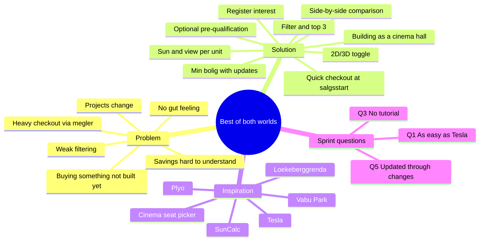
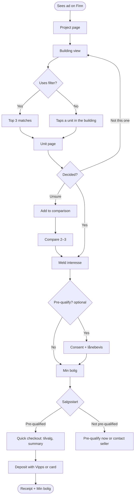
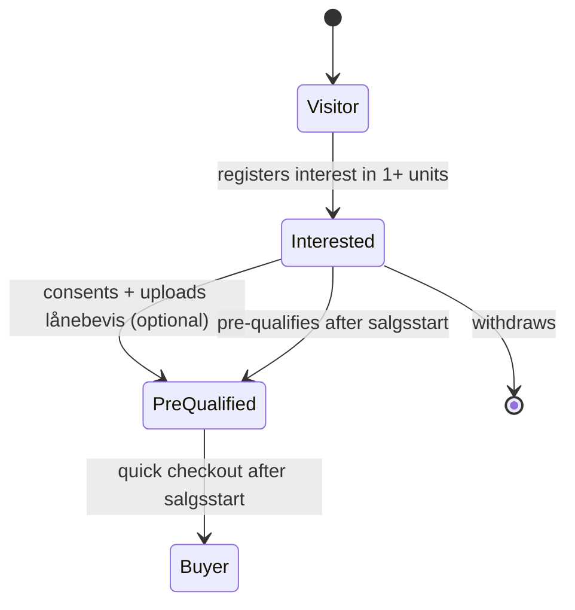
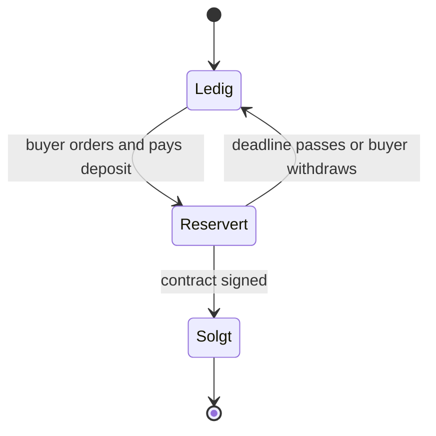
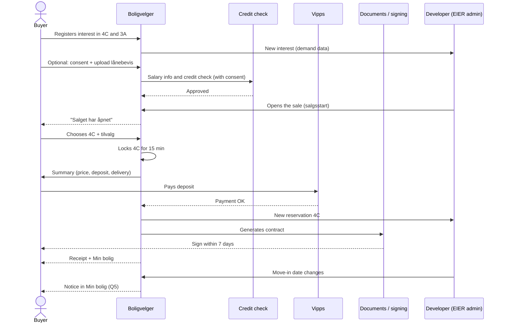
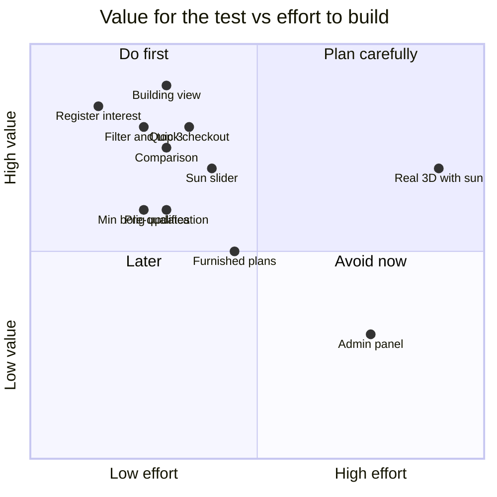

# Design Sprint: models

- Job: diagrams that summarise the sprint's thinking. Mermaid, rendered by GitHub.
- **Status: [interp] by Claude, 2026-11-24.** Built from `Insights.md`, `Storyboard.md` and `Priorities.md`; not drawn by the team.

## 1. Concept map

## 2. Prototype flow

## 3. States

Buyer, per project:

Unit:

Ranking by ansiennitet is not modelled (decision 24 Nov).

## 4. Order sequence (target product)

## 5. Impact vs effort (prototype)

## 6. Value on both sides of the market

| | Buyer | Developer / EIER |
| --- | --- | --- |
| Job to be done | Find the right unit, feel safe, secure it quickly | Sell the project fast, fill it with interested buyers |
| Pains | Uncertainty; no sun/view info; heavy process; too much text | Expensive megler hours; manual work; unsold units |
| Gains | Gut feeling digitally; comparison; ready to buy the moment the sale opens | Pre-qualified interest before salgsstart; fewer megler hours; data on demand |
| Our answer | Building view, sun/view, compare, register interest, optional pre-qualification, quick checkout at salgsstart, Min bolig | Admin panel, real-time status, insight into what buyers look at (CASE) |
