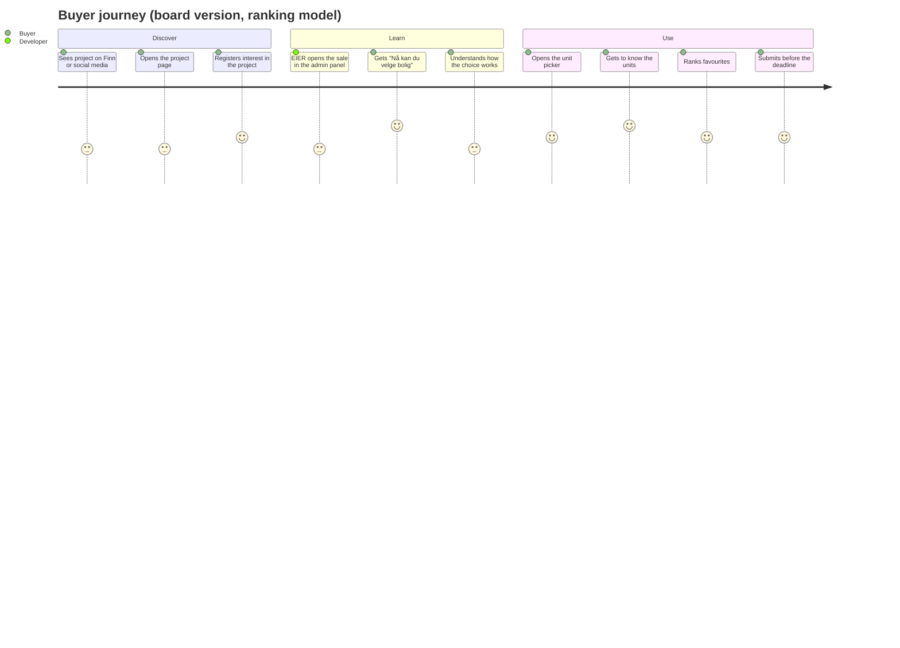

# Design Sprint: user journey, test flows and storyboard

- Job: the journey the team mapped, the individual 6-step user-test flows, and the final storyboard that defines the prototype.
- Source: Miro board (see `README.md`). Step texts quoted as written; headings, the flow labels A–D and the journey diagram are [interp].

## User journey (discover → learn → use)

Board text, in order:

- **Oppdag:** Ser prosjektet på Finn eller i sosiale medier → Går inn på prosjektsiden → Melder interesse for prosjektet (sammen med mange andre)
- **Lær:** EIER åpner salget i adminpanelet og slipper inn et utvalg av dem som meldte interesse → Får beskjed: «Nå kan du velge bolig» → Forstår hvordan valget fungerer: du rangerer boligene du vil ha, og boligene fordeles etter prioritet (ansiennitet)
- **Bruk:** Åpner boligvelgeren → Blir kjent med boligene (plantegning, etasje, sol, utsikt, pris) → Velger og rangerer favorittene i prioritert rekkefølge → Sender valget innen fristen
- **Mål:** Velger trygt den eller de boligene de vil ha, og vet nøyaktig hva de har valgt

This journey describes a ranking/ansiennitet model. The prototype uses direct purchase instead (decision in `README.md`).

## Individual user-test flows (6 steps)

| Step | Flow A | Flow B (matches the storyboard) | Flow C | Flow D |
| --- | --- | --- | --- | --- |
| 1 | Brukeren er på jakt etter bolig, og søker seg frem til løsningen. | Kjøper får opp prosjektannonse på finn.no eller sosiale medier. Trykker seg videre til boligportalen | Ser boligen/byggeprosjektet på finn eller lignende – går så inn på prosjektsiden | Bruker søker etter bolig på finn |
| 2 | Landingssiden, bruker får et godt inntrykk av området, tilgjengelige fasiliteter, og rask oversikt. | Får en oversikt over prosjektet og en 3D modell av bygget som kan roteres og som viser solforhold + omgivelser | Kan så velge bolig og åpner boligvelgeren | Blir videresendt fra finn-annonsen til boligvelgersiden |
| 3 | Bruker filtrerer etter sine nøkkelkrav | Trykker på bygget og kan se alle leiligheter. Bruker avansert filter på å finne de tre beste alternativene for sitt behov | Klar oversikt over hele bygget og trykker på en ledig leilighet | Brukeren finner umiddelbart ut hvordan siden fungerer og hvordan den skal brukes. |
| 4 | Bruker utforsker relle leiligheter, deres solforhold og planløsninger | Går gjennom alle tre digitalt med 3D view, bruker balkongutsikten for å se solforholdene i hver leilighet til alle døgnets tider | Ser pris, besparelse og plantegning | Brukeren kan enkelt filtrere etter bolig ved hjelp av avanserte filtre |
| 5 | Bruker finner ut av andre tekniske spørsmål de har rundt de utvalgte leilighetene | Sammenligner de to favorittene og får en detaljert side by side som tydelig forklarer forskjellene og bruker forstår bedre hva som er mest verdi for pengene | Sjekker utsikt og solforhold fra balkong | Brukeren finner riktig bolig og utforsker leiligheten ved hjelp av boligvelgerens funksjoner, som blant annet solkart. |
| 6 | Brukeren registrerer interesse på 1 eller flere boliger. | Bruker velger en leilighet, trykker bestill, betaler depositum med vipps og får alt av papirer og kontrakt i Boligvelger-Appen | Rangerer og sender valget | Bruker sender inn interesse |

Other notes on the matrix: "Velger ønsket prosjekt og får oversikt over boligene → Utforsker tilgjengelige boliger og området → Ser alt av praktisk info og ønskede tilpasninger → Rangere ønskede boliger → Melder interesse for kjøp eller visning", and "Brukeren ser solforhold i leiligheten, og vurderer om det er bra", "Bruker ser prisen, og hvor mye som blir spart", "Brukeren melder interesse/bud om personen liker leiligheten".

## Final storyboard (6 cells)

Initials at the top of the cells show who owns which cell (KN, MK, BN, PN, ME, ME); the board doesn't make the cell mapping certain, so it isn't repeated here.

| # | Cell [interp title] | Board content |
| --- | --- | --- |
| 1 | **Project ad on Finn** | "Kjøper får opp prosjektannonse på finn.no eller sosiale medier. Trykker seg videre til boligportalen". HKV on the cell: "hjelpe prosjekteier å fylle opp prosjektene med interessenter?" |
| 2 | **Project overview in 3D** | "Får en oversikt over prosjektet og en 3D modell av bygget som kan roteres og som viser solforhold + omgivelser". "Kartoversikt av nærområdet". "Bruker utforsker området og ser bygningen i sin helhet". |
| 3 | **Whole building + advanced filter** | "Trykker på bygget og kan se alle leiligheter. Bruker avansert filter på å finne de tre beste alternativene for sitt behov". "Bygget hvit = ledig, Svart = Opptatt". "Filter: Pris=4-6m Rom=2 Vestvendt Balkong". "viser dine 3 beste treff". "Topp 3 foreslåtte leiligheter: 1. = 4c 2. = 3a 3. = 2b". "3D/2D view knapp". Open note: "Toolbar på høyresiden?" |
| 4 | **Explore the top 3** | "Går gjennom alle tre digitalt med nøkkelinfo, plantegning og 3D view, bruker balkongutsikten for å se solforholdene i hver leilighet til alle døgnets tider". Times shown: "KL 0600", "KL 1530", "KL 2300". "Solbanesimulering, Lysinnslipp, tidsbasert simulering". "1 av 4 møblerings-muligheter". "uten solview i 2d". "Trykk på leiligheter for Detail View og 3D gjennomgang". Open note: "hvordan kommer bruker til plantegning fra 3d viewet?" |
| 5 | **Compare favourites** | "Sammenligner de to favorittene og får en detaljert side by side som tydelig forklarer forskjellene og bruker forstår bedre hva som er mest verdi for pengene". "ser pris, besparelse og plantegninger". "Knapp for å legge til i sammenligning". "velge flere og rangere flere enheter". |
| 6 | **Order (Tesla flow)** | "Bruker velger en leilighet, legger til tilvalg, trykker bestill, betaler depositum med vipps og får alt av papirer og kontrakt i Boligvelger-Appen". "Ordreflyt inspirert av Tesla". Alternative: "Brukeren kan registrere interesse på 1 eller flere boliger". "For mer informasjon kan du se i boligportalen til leilighetene". |

Linking buttons (green on the storyboard, per the method): "Se leilighet", "Knapp for å legge til i sammenligning", "3D/2D view knapp", bestill.

**[interp] Gap against the chosen sprint questions:** no cell covers Q5 (keeping buyers updated through a changing project). `Priorities.md` suggests a small "Min bolig" step after cell 6.
