# Design Sprint: layout and wireframes

- Job: design principles, screen map and low-fi wireframes for the prototype, one per storyboard cell.
- **Status: [suggestion] by Claude, 2026-11-24. Not agreed by the group.** Numbers and unit names are placeholders (4C, 3A, 2B come from the storyboard).
- UI text is Norwegian, as the prototype will be.

## Design principles

1. **Overview before detail:** show the whole building first, like a cinema hall (HKV: "skjønne hvordan man velger bolig med én gang").
2. **Status in colour, not text:** ledig, reservert and solgt are understood without reading.
3. **One obvious next step:** one primary button per screen (Q3: no tutorial).
4. **Show, don't tell:** sun, view and savings as visuals (HKV: "uten mye tekst").
5. **Full price overview all the way:** a fixed summary panel with price, tilvalg and deposit, as in Tesla's checkout (Q1).
6. **Familiar patterns only:** filters on the left, cards, a compare button, Vipps.

## Screen map

```mermaid
flowchart LR
  A[1 Prosjektside] -->|Velg bolig| B[3 Byggvisning + filter]
  B -->|Se leilighet| C[4 Leilighet<br/>plan · sol · utsikt · økonomi]
  C -->|Legg til i sammenligning| D[5 Sammenlign]
  B -->|Sammenlign topp 3| D
  C -->|Meld interesse| I[6a Interesse registrert]
  D -->|Meld interesse| I
  I -->|Valgfritt| P[6b Forhåndsgodkjenning<br/>samtykke + lånebevis]
  I --> H[7 Min bolig]
  P --> H
  H -->|Salgsstart, forhåndsgodkjent| E[6c Tilvalg]
  E --> F[6d Oppsummering og depositum]
  F -->|Vipps / kort| G[6e Kvittering]
  G --> H
```



## Shared frame (desktop)

```
┌──────────────────────────────────────────────────────────────────────┐
│ ◧ Boligvelgeren · <Prosjekt>         Bygg   Sammenlign (2)   ♡ (3)   │
├──────────────────────────────────────────────────────────────────────┤
│ ● Utforsk ─── ○ Velg ─── ○ Tilvalg ─── ○ Bestill                      │
└──────────────────────────────────────────────────────────────────────┘
```

## 1–2 Project page

```
┌──────────────────────────────────────────────────────────────────────┐
│  [ Large image / 3D render of the building, sun line in the sky ]    │
│  <Prosjekt> borettslag · Oslo                                        │
│  48 leiligheter · 2–4 rom · Fra 3,9 mill. · Innflytting 2028         │
│  [  Velg bolig  ]   [ Se området ]                                   │
├───────────────────────┬──────────────────────┬───────────────────────┤
│ ☀ Sol: vestvendte      │ 💰 Kjøp digitalt og   │ 🗺 Kart: skole,        │
│ balkonger              │ spar meglergebyr      │ T-bane, butikk, park  │
└───────────────────────┴──────────────────────┴───────────────────────┘
```

2D/3D toggle (Should, decided 24 Nov): **2D** = top-down map view (Google Maps style) with nearby facilities; **3D** = Google Earth-style view with sun lines in the sky.

## 3 Building view with filter

```
┌──────────────┬───────────────────────────────────────┬───────────────┐
│ FILTER       │      [2D | 3D]        Kl. ──●── 15:30 │ DINE 3 BESTE  │
│ Pris 4–6 m   │   ┌───┬───┬───┬───┐  5. etg           │ 1. 4C  5,2 m ♡│
│ ●──────●     │   │5A │5B │5C │5D │                   │    2 rom · V  │
│ Rom [1]●[3]  │   ├───┼───┼───┼───┤  4. etg           │ 2. 3A  4,8 m ♡│
│ Balkong      │   │4A │4B │▓4C│4D │                   │ 3. 2B  4,4 m ♡│
│ ○N ○Ø ○S ●V  │   ├───┼───┼───┼───┤                   │               │
│ Etasje 2–5   │   │3A▓│3B │3C │3D │  □ ledig          │ [Sammenlign   │
│ Min 50 m²    │   ├───┼───┼───┼───┤  ▒ reservert      │   alle 3 ]    │
│ [Nullstill]  │   │2A │2B▓│2C │2D │  ■ solgt  ▓ treff │               │
└──────────────┴───────────────────────────────────────┴───────────────┘
  Tap a unit → quick card: pris, rom, m², [Se leilighet] [♡]
```

Answers the board's "Toolbar på høyresiden?" with: filters left, results right. [suggestion]

## 4 Unit page

```
┌──────────────────────────────────────┬───────────────────────────────┐
│ Leilighet 4C · 4. etasje             │ Pris          5 200 000       │
│ [Plantegning] [3D] [Utsikt]          │ Innskudd        520 000       │
│ ┌──────────────────────────────┐     │ Fellesgjeld   4 680 000       │
│ │  FLOOR PLAN (dimensions)     │     │ Felleskost.   7 450 / mnd     │
│ │  Møblering: ◀ 1 av 4 ▶       │     │ ───────────────────────────── │
│ └──────────────────────────────┘     │ 💰 Spart meglergebyr   50 000 │
│ SOL PÅ BALKONGEN                     │ Totalpris          5 200 000  │
│ 06 ─────────●────── 23   15:30       │                               │
│ ☀ Full sol på balkongen nå          │                               │
│ ▁▂▅█████▇▅▂▁  7,5 soltimer i dag    │ [♡] [⇄ Sammenlign]            │
│                                      │ [  Meld interesse  ]          │
└──────────────────────────────────────┴───────────────────────────────┘
```

The tabs answer "hvordan kommer bruker til plantegning fra 3d viewet?". [suggestion]

## 5 Compare

```
┌───────────────────────┬────────────────┬────────────────┬───────────┐
│                       │ 4C             │ 3A             │ 2B        │
├───────────────────────┼────────────────┼────────────────┼───────────┤
│ Pris                  │ 5,2 m          │ 4,8 m          │ 4,4 m ✓   │
│ Størrelse             │ 54 m² ✓        │ 52 m²          │ 49 m²     │
│ Pris per m²           │ 96 300         │ 92 300         │ 89 800 ✓  │
│ Soltimer balkong      │ 7,5 t ✓        │ 6 t            │ 4 t       │
│ Etasje / utsikt       │ 4 / åpen ✓     │ 3 / park       │ 2 / gård  │
│ Felleskost. per mnd   │ 7 450          │ 7 100          │ 6 600 ✓   │
│ Plantegning           │ [mini]         │ [mini]         │ [mini]    │
├───────────────────────┼────────────────┼────────────────┼───────────┤
│                       │ [Velg denne]   │ [Velg denne]   │ [Velg]    │
└───────────────────────┴────────────────┴────────────────┴───────────┘
  «4C gir 1,5 t mer sol per dag for 400 000 mer enn 3A»
```

## 6a–b Register interest and optional pre-qualification

```
┌──────────────────────────────────────────────────────────────────────┐
│ ✓ Interesse registrert for 4C og 3A                                  │
│ Salgsstart: 15. januar 2027. Vi varsler deg.                         │
│                                                                      │
│ Vil du være klar til å kjøpe med én gang ved salgsstart? (valgfritt) │
│ ☐ Jeg samtykker til innhenting av lønnsinfo og kredittsjekk          │
│ [ Last opp lånebevis ]  finansieringsbevis.pdf ✓                     │
│ [ Bli forhåndsgodkjent ]            [ Hopp over ]                    │
└──────────────────────────────────────────────────────────────────────┘
```

## 6c–e Quick checkout at salgsstart (Tesla-inspired)

Shown only after salgsstart, for pre-qualified users. In the prototype a "salgsstart" switch opens it.

```
┌──────────────────────────────────────┬───────────────────────────────┐
│ TILVALG                              │ OPPSUMMERING (fixed)          │
│ Kjøkken  ○ Standard  ● Eik  +45 000  │ Leilighet 4C      5 200 000   │
│ Gulv     ● Lys eik   ○ Mørk +18 000  │ Kjøkken eik         +45 000   │
│ Bad      ○ Standard  ● Flis +22 000  │ Bad flis            +22 000   │
│ Ekstra   ☐ Sportsbod     +60 000     │ Totalt            5 267 000   │
│                                      │ Spart meglergebyr   50 000    │
│                                      │ Til forfall i dag    10 000   │
│                                      │ Estimert levering Q1 2028     │
│                                      │ [ Bestill med Vipps ]         │
│                                      │ [ Bestill med kort  ]         │
└──────────────────────────────────────┴───────────────────────────────┘
→ Receipt: «Leilighet 4C er reservert til deg. Kontrakt og dokumenter ligger i Min bolig.»
```

## 7 Min bolig (for Q5)

```
┌──────────────────────────────────────────────────────────────────────┐
│ Min bolig · Interesse: 4C, 3A · Forhåndsgodkjent ✓ · Salgsstart 15.01│
│ ⚠ Endring 12.03.2027: Innflytting flyttet fra Q3 til Q4 2028. Hvorfor?│
│ Fremdrift: ●──●──●──○──○  Grunnarbeid · Råbygg · Tett bygg · Innflytt │
│ Dokumenter: Kontrakt (signer) · Leveransebeskrivelse · Tilvalg        │
│ Varsler: ☑ e-post  ☑ push                                            │
└──────────────────────────────────────────────────────────────────────┘
```

## Mobile

Same flow; filter as a bottom sheet, building view with pinch-zoom, summary as a fixed bottom bar with price and button. Findings theme 12 (6/21) says project sites work badly on mobile.
