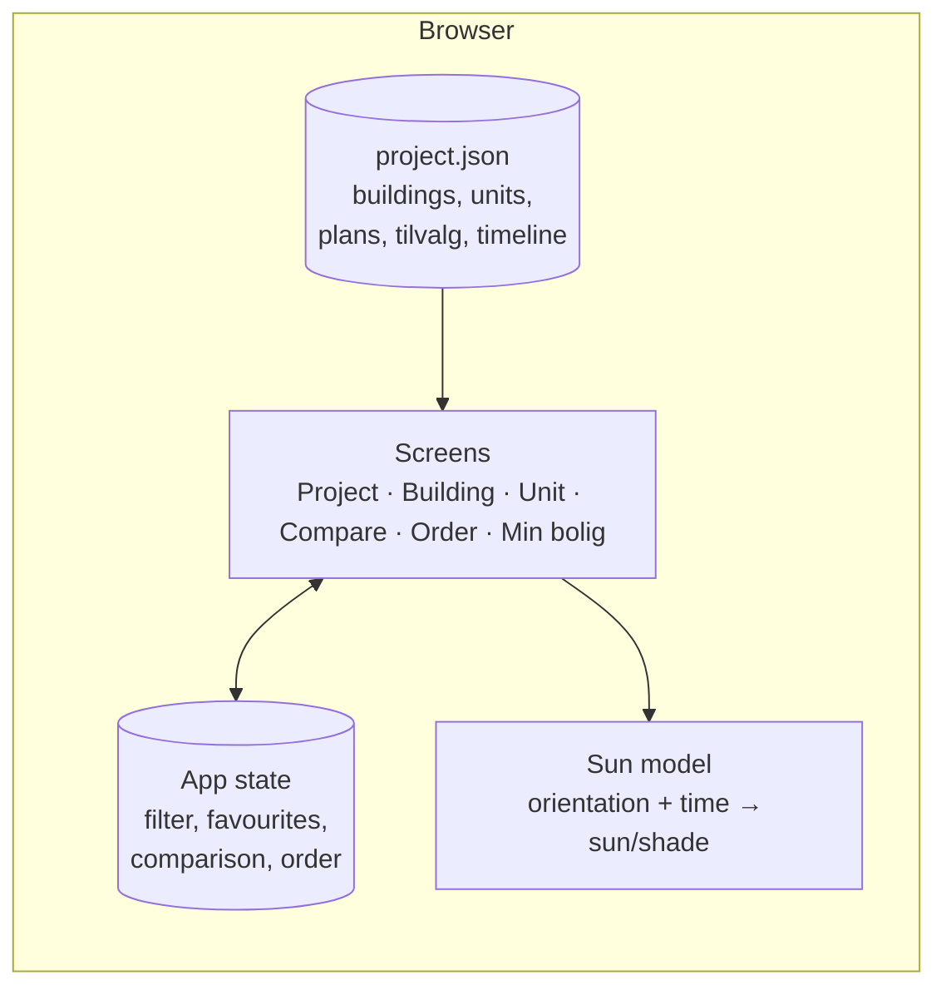
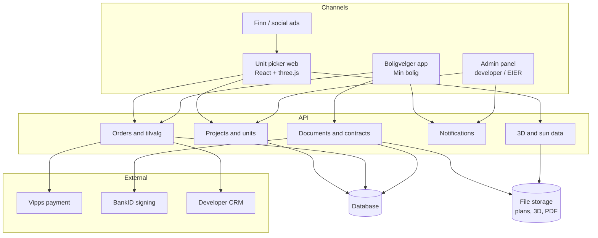
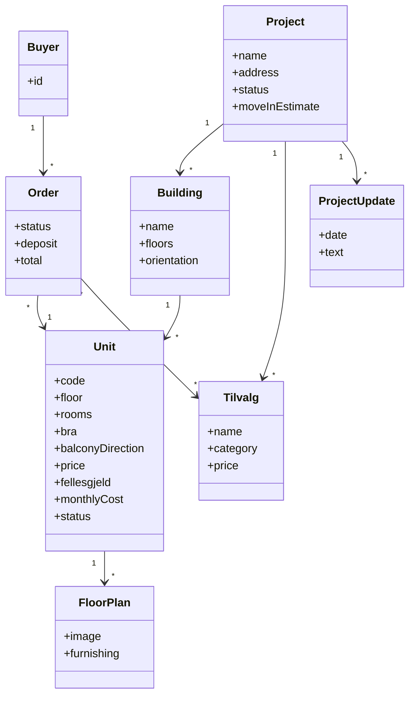

# Architecture (draft)

- Job: how the unit picker is built: (A) the prototype for the Design Sprint and sprints 1–3, and (B) a target picture for a real product.
- **Status: [suggestion] by Claude, 2026-11-24. Not agreed by the group.** Extends the technical sketch in `Proposal.md` (same stack) with the Design Sprint result (`docs/design-sprint/README.md`). Technology choices are outside the course material.
- Where product code lives is still open (`docs/Timeline.md` P1 step 9).

## A. Prototype

A clickable web app on fictional data. Runs in the browser, shareable as a link, no backend.

| Choice | Why |
| --- | --- |
| React + TypeScript (Vite), as in `Proposal.md` | Fast to build and change between test rounds; FMU skills |
| Building drawn in SVG (facade with tappable units) | Gives the cinema pattern without 3D cost; 3D can be an image at first |
| Sun: SunCalc with the balcony's orientation, or a simple lookup | Answers "sun on the balcony at 15:30?" without a 3D model |
| Floor plans as SVG | Allows furnishing variants and dimensions |
| Vipps, BankID and signing simulated | The test is about perceived trust, not integration |
| Favourites and order in local storage | No server, no personal data leaves the browser (Findings: 0/20 share income or ID) |

## B. Target product

EIER's real platform already has project pages, an admin panel and a unit picker [CASE]; this picture shows where our parts would sit, not a system to build in the course.

### Domain model

## Principles [suggestion]

1. **One source for unit data:** units, plans and 3D come from the same data, so status and prices never disagree (Findings theme 13: status out of date, 4/21).
2. **Real-time status:** two buyers can't reserve the same unit.
3. **Privacy by default:** no income, equity or ID number collected for recommendations (Findings); cyber students can review the order flow's data handling.
4. **Everything the buyer chose and signed in one place** ("Min bolig").
